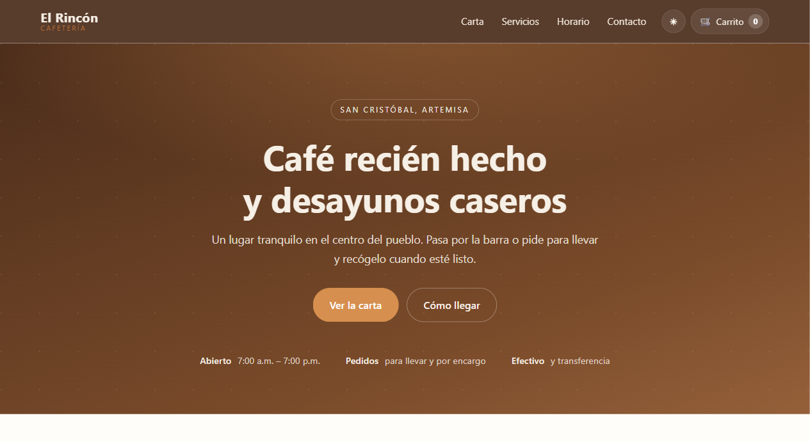
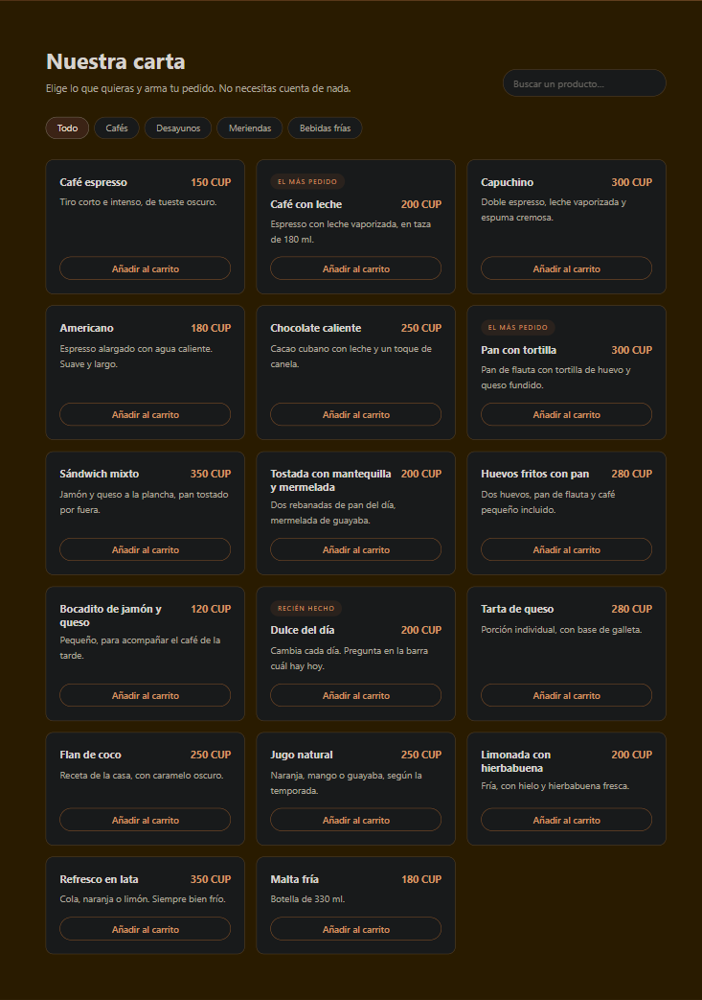

# Portal web: Cafetería El Rincón

Sitio web de una cafetería en San Cristóbal, Artemisa. Hecho con HTML, CSS y
JavaScript, sin dependencias, sin frameworks y sin proceso de compilación.

La idea es que sirva como plantilla para cualquier negocio pequeño: se cambian los
datos de un solo archivo y el sitio queda listo para entregar a un cliente.



## Qué incluye

- **Carta interactiva**: 17 productos cargados desde `datos.js`, con filtros por
  categoría y búsqueda que ignora tildes y mayúsculas.
- **Carrito de pedido**: añadir, cambiar cantidades y quitar productos. El contenido
  se guarda en `localStorage`, así que sobrevive a una recarga o a cerrar el navegador.
- **Pedido por WhatsApp**: el carrito genera un resumen con nombre, teléfono, forma de
  entrega, nota para la cocina y el total, y lo envía por WhatsApp al número del negocio.
  Si el navegador bloquea la ventana, el texto se puede copiar con un botón.
- **Tema claro y oscuro**: botón en la cabecera, con la preferencia guardada y respeto
  por la configuración del sistema en la primera visita. El cambio se dibuja con una
  onda circular que nace en el botón, usando la API de transiciones de vista con vuelta
  atrás instantánea en los navegadores que no la soportan.
- **Horario inteligente**: resalta el día actual y calcula si el negocio está abierto
  en ese momento.
- **Diseño adaptable**: una columna en teléfonos, rejilla de varias columnas en
  computadoras, con menú desplegable en pantallas pequeñas.
- **Accesibilidad**: enlace para saltar al contenido, etiquetas asociadas a los campos,
  avisos con `aria-live`, cierre del carrito con la tecla Escape y foco devuelto al botón
  de origen.



## Estructura

```
portal-cafeteria/
├── index.html          estructura y contenido
├── style.css           estilos, temas claro/oscuro y diseño adaptable
├── datos.js            negocio, categorías y productos  ← se edita para cada cliente
├── script.js           carta interactiva, carrito y pedido
└── docs/capturas/      imágenes usadas en este README
```

## Cómo ejecutarlo

La forma más cómoda, con recarga automática al guardar:

1. Abre la carpeta en VS Code.
2. Clic derecho sobre `index.html` y elige **Open with Live Server**.

También se puede abrir `index.html` con doble clic, pero algunos navegadores guardan
en caché la hoja de estilos y los scripts y no muestran los cambios. Si eso pasa, carga
la página con `Ctrl + Shift + R`.

## Cómo adaptarlo a otro negocio

Todo el contenido editable está en `datos.js`:

- `negocio`: nombre, teléfono, número de WhatsApp y dirección.
- `categorias`: las secciones de la carta.
- `productos`: nombre, categoría, descripción, precio y etiqueta opcional.

El precio se escribe como número (`300`) y el sitio lo muestra formateado en pesos
cubanos. Para cambiar los textos de la portada, los servicios o el horario se edita
`index.html`.

## Cómo se envía el pedido

No hay servidor ni base de datos. Al confirmar, el sitio arma un mensaje de texto y abre
un enlace `https://wa.me/<número>?text=<mensaje>`. El cliente termina la conversación en
WhatsApp, que es lo que ya usan la mayoría de los negocios pequeños.

Esa decisión es deliberada: permite tener un flujo de pedido completo y real sin depender
de una pasarela de pagos ni de un servicio de correo, que son las dos cosas más difíciles
de contratar desde Cuba.

## Próximas mejoras

- Galería de fotos de los productos (las imágenes no están incluidas).
- Panel de administración para editar la carta sin tocar el código (siguiente etapa:
  Python con base de datos).
- Guardar los pedidos en una base de datos en lugar de depender de WhatsApp.
- Pasarela de pago, cuando el cliente tenga una cuenta que funcione desde su país.

## Autor

Darío Verdecia, estudiante de Ingeniería en Ciencias Informáticas en la UCI.
Contacto: verdecialopezdario@gmail.com
